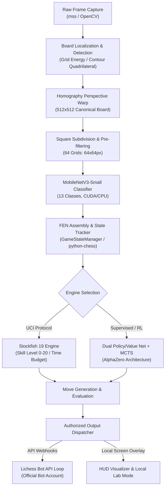

# Vision-Based Chess AI & Real-Time Engine (Educational Research)

[](https://www.python.org/downloads/)
[](https://pytorch.org/)
[](https://opencv.org/)
[](LICENSE)
[](#disclaimer--fair-play-policy)

---

## ⚠️ Important Disclaimer & Fair Play Policy

> **STRICT COMPLIANCE NOTICE:**
> 
> This repository is developed **strictly for academic research, computer vision experimentation, and educational purposes**.
> 
> * **NO HUMAN OPPONENTS:** This software must **never** be used against human opponents on commercial platforms (including Chess.com, Lichess, Chess24, or any competitive server).
> * **FAIR PLAY POLICIES:** Using automated engines or vision assistance in competitive matches against human players constitutes a severe violation of Terms of Service and Fair Play rules, resulting in permanent account termination and IP/hardware restrictions.
> * **AUTHORIZED ENVIRONMENTS:** Live autonomous play testing is only permitted against **offline local engines**, designated **offline computer bots** (e.g., local test harness mode), or registered bots on official developer APIs such as the **[Lichess Bot API](https://lichess.org/api#tag/Bot)** where automated agents are explicitly licensed and badged.
> 
> The authors and contributors assume no liability for misuse, policy violations, or sanctions incurred through unauthorized deployment of this software.

---

## 📖 Project Overview

**Vision-Based Chess AI** is a modular, end-to-end Python system combining real-time computer vision, deep learning spatial classification, and chess engine search architectures:

1. **Vision Perception Pipeline:** Captures screen or webcam feeds, detects board perspective quads via edge-energy Sobel filters, projects to an orthographic 512×512 top-down plane via homography warping, and classifies all 64 squares into 13 classes (6 piece types × 2 colors + empty).
2. **State & Move Inference Engine:** Converts 8×8 predicted grids into valid FEN notation, diffs consecutive positions to deduce legal moves with disambiguation via `python-chess`, and maintains castling, en passant, and half-move clocks.
3. **Engine Evaluation Stack:** Integrates a UCI Stockfish wrapper with configurable search depths and skill levels alongside an AlphaZero-style Dual Policy/Value convolutional network with Monte Carlo Tree Search (MCTS).
4. **Authorized Bot Protocol:** Implements asynchronous real-time match negotiation, clock-aware time budgeting, and game logging over the official Lichess Bot API.

---

## 🏗️ System Architecture



---

## 📦 Repository Structure

```
chess-vision-ai/
├── config.yaml               # Global parameters: thresholds, engine paths, timeouts
├── requirements.txt          # Python dependencies
├── main.py                   # Central unified CLI & GUI launcher
├── LICENSE                   # Open-source MIT license
├── README.md                 # Project documentation & guidelines
├── vision/                   # Phase 1: Computer vision perception
│   ├── capture.py            # DPI-aware MSS screen grabber & webcam stream
│   ├── board_detect.py       # Axis-aligned grid energy detector & homography warp
│   ├── squares.py            # 64-square subdivision & coordinate conversions
│   ├── classifier.py         # MobileNetV3-Small inference module
│   ├── template_classifier.py# Hybrid occupancy pre-filter & template matcher
│   ├── state.py              # Grid to FEN mapping, move diffing, and legal validation
│   └── overlay.py            # Real-time CV2 HUD dashboard and visual badges
├── data/                     # Dataset synthesis & augmentation
│   └── generate_dataset.py   # Multi-theme synthetic board generator with noise/lighting
├── training/                 # Model training pipelines
│   ├── train_classifier.py   # PyTorch AMP training script for 13-class square CNN
│   └── train_policy.py       # Supervised policy & value network training on PGNs
├── engine/                   # Phase 2 & 3: Chess engines
│   ├── base.py               # Abstract BaseEngine interface
│   ├── stockfish_engine.py   # UCI wrapper with depth, Elo limits, and analysis
│   └── neural_engine.py      # Dual-head policy/value ResNet with MCTS search
├── play/                     # Execution loops
│   ├── launcher_gui.py       # Interactive Tkinter setup dashboard
│   ├── local_test_mode.py    # Local computer bot validation loop & HUD
│   └── lichess_bot.py        # Official Lichess Bot API real-time game client
├── scripts/                  # Utilities & benchmarks
│   ├── download_stockfish.py # Automated Stockfish binary installer
│   ├── benchmark_neural.py   # Match neural network against Stockfish across Elo tiers
│   └── test_template_clf.py  # Local evaluation script for square detection
└── tests/                    # Pytest verification suite
    ├── test_vision.py        # Perspective warp, grid split, coordinate mapping tests
    ├── test_classifier.py    # Per-square accuracy & confusion matrix assertions
    ├── test_engine.py        # Stockfish UCI lifecycle, timing, and move legality
    └── test_state.py         # Move deduction and FEN generation unit tests
```

---

## ⚡ Installation & Setup

### Prerequisites
* **Operating System:** Windows 10/11, Ubuntu 22.04+, or macOS 12+
* **Python:** 3.11 or newer
* **GPU (Recommended):** NVIDIA RTX series with CUDA 12.x for mixed-precision training and fast inference. CPU fallback is automatically supported.

### 1. Clone Repository & Setup Virtual Environment
```bash
git clone https://github.com/your-username/chess-vision-ai.git
cd chess-vision-ai

# Create virtual environment
python -m venv .venv

# Activate environment
# On Windows (PowerShell):
.\.venv\Scripts\Activate.ps1
# On Linux / macOS:
source .venv/bin/activate
```

### 2. Install Dependencies
```bash
pip install --upgrade pip
pip install -r requirements.txt
```

### 3. Download Stockfish Engine
Automated download script installs the official Stockfish binary:
```bash
python scripts/download_stockfish.py
```
*Binary is placed inside `./stockfish/` and referenced automatically in `config.yaml`.*

---

## 🚀 Execution & Usage Modes

### 1. Interactive GUI Launcher (Recommended)
Launch the configuration and control dashboard:
```bash
python main.py
```
Provides visual options for screen capture calibration, theme selections, engine configuration, and one-click session launch.

---

### 2. Live Vision HUD (Local Testing)
Runs the continuous real-time capture and live HUD visualizer:
```bash
python main.py --live
```
**Keyboard Controls in HUD Window:**
| Key | Action |
|:---:|:---|
| **`m`** / **Space** | Trigger single best-move execution in local vs-computer test mode |
| **`a`** | Toggle continuous Auto-Move mode |
| **`r`** | Resynchronize internal game board state with screen FEN |
| **`f`** | Flip board orientation (White ↔ Black at bottom) |
| **`c`** | Toggle active player color (White ↔ Black) |
| **`s`** | Save current frame and overlay snapshot to `debug_frames/` |
| **`q`** / `Esc` | Cleanly terminate session |

---

### 3. Training the Square Classifier
To train or fine-tune the 13-class MobileNetV3 model:
```bash
python main.py --train --train-samples 120000 --val-samples 20000 --epochs 10 --batch-size 256
```
*Generates high-diversity synthetic boards across multiple themes, highlights, and piece sets, evaluating strictly against held-out validation sets.*

---

### 4. Training the Supervised Policy/Value Engine (Phase 3)
Download Lichess open database PGN files into `data/pgn/` and run:
```bash
python main.py --train-policy --pgn-dir data/pgn --min-elo 1800 --policy-epochs 10
```

---

### 5. Running the Lichess Bot Client (Phase 4)
To run legal autonomous matches on Lichess:
1. Register a BOT account on [Lichess.org](https://lichess.org).
2. Generate an API token with `bot:play` permissions.
3. Export token to environment variables:
   ```bash
   # Windows PowerShell
   $env:LICHESS_BOT_TOKEN="your_personal_token_here"
   
   # Linux / macOS
   export LICHESS_BOT_TOKEN="your_personal_token_here"
   ```
4. Start bot daemon:
   ```bash
   python main.py --lichess --engine stockfish --skill 10
   ```

---

## 🧪 Automated Test Suite

Run full regression and unit test suite across vision, state inference, and engine modules:
```bash
pytest tests/ -v
```

---

## 📜 Ethical Use & Research Attribution

This project is licensed under the **MIT License**. See [`LICENSE`](LICENSE) for complete terms.

When citing this work or using components for academic research:
```bibtex
@software{chess_vision_ai_2026,
  title  = {Vision-Based Chess AI: Real-Time Perception, Spatial Piece Classification, and Engine Inference Pipeline},
  year   = {2026},
  url    = {https://github.com/your-username/chess-vision-ai}
}
```
